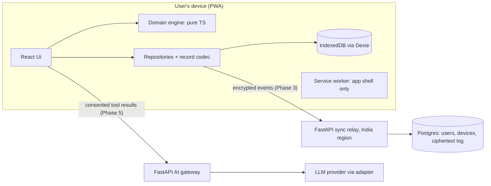

# 02 – Architecture Decisions

Each member uses Lekka on their own phone, so households connect through end-to-end encrypted sync. Phases 0–2 ship as a pure static PWA; FastAPI arrives in Phase 3 as an encrypted sync relay hosted in India and adds a stateless AI gateway in Phase 5. Every financial calculation runs on the device.

## System overview



## Stack clarifications

| Concern | Choice | Note |
| --- | --- | --- |
| Local reactive data | Dexie `liveQuery` / `useLiveQuery` | Not Zustand, not TanStack Query. Updates across tabs automatically. |
| UI state | Zustand | Active profile, lock state, UI preferences only. |
| Server state | TanStack Query | AI and sync endpoints only. |
| Forms and validation | React Hook Form + Zod | Zod schemas shared by forms, import, restore and AI output parsing. |
| UI kit | Tailwind CSS + shadcn/ui + Lucide | |
| Charts | Recharts, lazy-loaded | Keep the Quick Add path free of chart code. |
| Dates | `LocalDate` strings with integer calendar maths (`domain/periods`); "today" via `Intl.DateTimeFormat` in the household timezone | date-fns v4 + `@date-fns/tz` to be added when recurring rules need them (4.6), not before (ADR-045). |
| i18n | i18next + react-i18next | English only in v1; all strings externalised from day one. |
| Lists | TanStack Virtual | Virtualise long transaction lists. |
| Routing | react-router 7, declarative mode | `BrowserRouter` + `Routes`; nav lists only screens that exist (ADR-039, ADR-040). |
| Theme | CSS variables in Tailwind `@theme`; `prefers-color-scheme` by default, `<html data-theme>` for an explicit choice | Preference kept in localStorage (UI preference, not financial data; ADR-041). |
| Local encryption | Web Crypto AES-256-GCM | Argon2id via libsodium `crypto_pwhash` (same library as sync, ADR-034). |
| Sync crypto | libsodium (`libsodium-wrappers-sumo`) | X25519 sealed boxes for key envelopes, Ed25519 device signatures. |
| Spreadsheets | SheetJS from its official distribution, lazy-loaded | The npm-registry package is outdated; install per SheetJS docs. |
| PWA | vite-plugin-pwa | Precache build assets only; no runtime caching of any `/api` route. |
| Tests | Vitest, fake-indexeddb, fast-check, React Testing Library, Playwright, axe | fast-check property tests for every money function. |
| Backend | FastAPI, Pydantic v2, HTTPX | Postgres for non-financial metadata and ciphertext. SQLAlchemy Core or asyncpg is acceptable here. |
| AI provider | OpenAI-compatible adapter, provider set by config | Default: a free tier that does not train on inputs (see 06). |
| Auth (Phase 3) | Passkeys (WebAuthn) with email magic-link fallback | Use a maintained WebAuthn library; no passwords stored. |
| Hosting | Frontend: Cloudflare Pages (must send real CSP headers, ADR-031). Node 24 LTS, pnpm. Backend: India region (for example AWS Mumbai ap-south-1 or GCP asia-south1) | Keep the cloud provider swappable. |

## Frontend layers

Dependencies point one way: `features → data → domain`. `domain` imports nothing from React, Dexie or the browser.

```text
src/
  domain/      types, money, periods, calculations, budget rules, advisor engine, NL parser (pure, fully unit-tested)
  data/        Dexie db, schema versions, migrations, repositories, record codec, backup format
  features/    onboarding, home, quick-add, transactions, budgets, accounts, income, recurring, goals,
               members, insights, advisor, assistant, backup, sync, settings (UI + hooks)
  platform/    PWA install, storage persistence, share target, app lock, BroadcastChannel, Web Locks
  services/    API clients for the AI gateway and sync relay
  components/  ui (shadcn), layout, charts, common
  i18n/        locale files (en only in v1)
```

Repository layout:

```text
lekka/
  frontend/
  backend/          (created in Phase 3)
  docs/             01–08 knowledge files (08 is the live progress file)
  CLAUDE.md         (copy of PROJECT-INSTRUCTIONS.md if using Claude Code)
  .github/workflows/
  docker-compose.yml (Phase 3+)
```

## Storage design

**Repository + codec from day one.** All reads and writes go through repositories. Each repository runs records through a codec. In Phase 1 the codec is identity; in Phase 2 it encrypts. Adding App Lock is then a migration, not a rewrite.

**Record envelope.** Every stored record has a small plaintext header and a payload:

| Plaintext header (indexed) | Payload (encrypted when App Lock is on) |
| --- | --- |
| `id`, `householdId`, `kind`, `month` (YYYY-MM of the record's date; `null` for undated records such as categories and budgets), `updatedAt`, `deletedAt`, `rev` | Everything else: amounts, descriptions, merchants, notes, category and member references |

Encrypted fields cannot be indexed, so queries load a range of `month` buckets by index (a budget period with start day ≠ 1 spans two buckets), decrypt, then filter and aggregate in memory. After unlock, an in-memory cache of decrypted records serves search and analytics and is invalidated on write. Ten years at 150 transactions a month is about 18,000 records, comfortably in-memory on a mid-range phone. The plaintext `month` field reveals how many records exist per month; this trade-off is documented in 04.

**Durability rules.**

- Call `navigator.storage.persist()` after the first saved transaction; show the result in Settings → Data safety.
- Show usage from `navigator.storage.estimate()`. Handle `QuotaExceededError` with a clear message and a backup prompt.
- iOS Safari may delete storage for sites not added to the Home Screen after 7 days without use. On iOS, prompt to install before the user has meaningful data, and say why.
- Multi-table writes (transaction + audit entry) use a single Dexie transaction.
- Migrations use Dexie `version(n).upgrade()`. A released schema version is never edited. Each migration has a test that opens a fixture database from the previous version.
- Settings → Data safety includes an integrity check: transfers missing a side, refunds without an original, records failing schema validation.
- Use Web Locks for migrations, backup and restore so two tabs never run them at once.
- Optional on Chromium desktop: automatic backup to a user-chosen folder via the File System Access API.

**Service worker.** Precache the app shell. Never cache API responses. On a new version, show "Update available – reload" rather than silently activating, so the UI and database schema never run mismatched versions.

## Backend role by phase

| Phase | Endpoints | Stores |
| --- | --- | --- |
| 0–2 | None | Nothing |
| 3 | Auth, households, invitations, devices, sync push/pull, `/health` | Users, memberships and roles, device public keys, invitations, wrapped key envelopes, ciphertext event log |
| 5 | Adds the `/api/v1/ai/*` gateway (stateless; request bodies never logged) | Nothing new |

The server may use Postgres for accounts and ciphertext, and must never hold plaintext financial data or the keys to decrypt it.

## Architecture decision records

| ADR | Decision | Consequence |
| --- | --- | --- |
| 001 | IndexedDB via Dexie is the only store of financial data | Backup and restore are core features |
| 002 | Money stored as integer paise | No decimal library needed except interest maths, which rounds at the boundary |
| 003 | Repository + codec layer from Phase 0 | App Lock can be added without touching features |
| 004 | Encrypted payload, minimal plaintext header | Queries by period, then in-memory filtering |
| 005 | Accounts model with typed transactions (03) | Transfers and card payments never double-count |
| 006 | No backend until Phase 3 | Phases 0–2 deploy as static files |
| 007 | AI uses tool calls into the local engine | LLM never computes numbers; minimal data leaves the device |
| 008 | Purchase advisor verdict is deterministic | LLM explains, never decides |
| 009 | Sync is an append-only encrypted operation log with a server sequence number | Server is a dumb relay; ordering and idempotency are simple |
| 010 | Conflicts merged per field; same-field concurrent edits surfaced to the user | No silent overwrites |
| 011 | libsodium for sync keys, Web Crypto for bulk encryption | No custom protocols |
| 012 | Scheduled items never auto-create transactions | Committed vs actual stays honest |
| 013 | In shared-device mode, one App Lock for the device; profiles there are attribution only | Simple unlock on shared devices |
| 014 | Splits and member balances deferred to Phase 6 | Every expense attributed fully to the payer until then |
| 015 | Provider-independent AI adapter; default free tier that does not train on inputs; BYOK supported | See 06 |
| 016 | Sync backend hosted in India | Disclose any AI processing outside India |
| 017 | v1 English only; regional languages in Phase 6 | i18n infrastructure still required from Phase 0 |
| 018 | Progress tracked in 08-progress.md, regenerated by Claude every session | One file replacement per session |
| 019 | One person per phone by default; shared-device mode opt-in; sync moved to Phase 3, App Lock to Phase 2 | Members on other phones need an account and sync; Local Only stays for single users and shared devices (ADR-022) |
| 020 | Individuals fully supported: solo mode, solo-to-family upgrade, multiple spaces per device | Every record and query is scoped by `householdId`; sync and keys are per space |

New ADRs are appended in 08-progress.md (from ADR-021) and folded into this table at the end of each phase.
